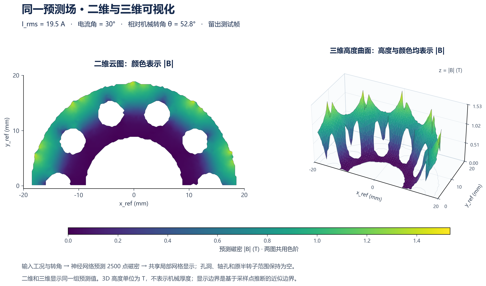

# Maxwell 转子磁密 · 2D / 3D 神经网络可视化

[打开网站](https://xin02350-eng.github.io/maxwell-rotor-field-viewer/) · [使用与方法说明](https://xin02350-eng.github.io/maxwell-rotor-field-viewer/guide.html)

输入工况与转子位置，比较 Maxwell 真值、神经网络预测和绝对误差。支持二维磁密云图、可旋转三维磁密高度图、工况切换、300帧播放、参考/世界坐标、原始点/局部曲面、CSV与PNG导出。



## 数据与模型

- 12组工况：16.7、19.5、24.5、27.3 A RMS × 电流角0°、30°、60°；转速1200 rpm。
- 每工况300个机械位置索引（磁场每30°近重复），每帧取原8500点中的2500个转子铁芯点；覆盖参考系中的半转子。
- 3D竖直轴是磁密大小（T），不是轴向几何坐标或实体厚度。
- 模型：64维POD + 条件MLP（2→32→32→832）+ 六阶30°周期Fourier展开。
- 约30°重复周期内的等效相位保持在同一数据集合，训练/验证/测试为15/5/5个相位。所有均值、POD和网络仅由各自训练标签拟合。

| 内部留出任务 | 神经网络RMSE | 相对L2误差 |
|---|---:|---:|
| 已知工况的未训练转角 | 0.000152681 T | 0.020310% |
| 完整留出19.5 A三工况 | 0.002050856 T | 0.271885% |
| 完整留出30°电流角四工况 | 0.008126870 T | 1.083539% |

已知工况角度拟合很好；整组新工况的神经网络暂未优于相邻工况插值。以上为同批仿真的内部留出评估，不是独立Maxwell外部盲测。详见[实验报告](downloads/results-report.md)及[完整指标](research/metrics.json)。

## 网站数据

网站展示 `rotor_angle_evaluation` 模型的结果，而非全数据重拟合模型的训练成绩。真值与预测按工况拆分加载，首次仅下载当前工况；无需后端、无需登录、没有第三方统计或上传接口。

磁密在网页中量化为16位用于显示，单值最大舍入误差约1.17×10⁻⁵ T；指标由未量化数据计算。三角网只连接邻近样本，保留4561面、2500点及可见孔洞，是采样边界近似，不是CAD或原始有限元网格。

## 本地启动

```powershell
python -m http.server 8000 --bind 127.0.0.1
```

浏览器打开 `http://127.0.0.1:8000/`。网站版需要通过HTTP访问以按需读取数据文件；离线单HTML版本由之前的交付包提供。

## 用模型生成新预测

仅NPZ推理需要NumPy，训练另需PyTorch：

```powershell
python -m pip install numpy
python research/rotor_model.py --model models/rotor_production.npz --current 22.5 --phase 30 --theta 45 --output prediction.csv
```

电流参数为A RMS；转角为相对第一帧的机械角。世界坐标对应相对角+36°。模型输出固定2500点的磁密，不支持新几何、新空间点或未经验证的范围外外推。生产模型使用了全部标签，不能用其训练拟合误差代替测试误差。

## 复现训练

原始压缩包不重复存入本仓库。取得 `twelve_conditions_8500_compact.zip` 后：

```powershell
python -m pip install -r research/requirements.txt
python -m pip install torch==2.14.1 --index-url https://download.pytorch.org/whl/cpu
python research/prepare_rotor.py "path/to/twelve_conditions_8500_compact.zip"
python research/train_rotor.py
```

中间数据写到 `work/`，重训模型写到 `research/`。随机种子42，CPU四线程。源码与已有发布模型分别保存在 `research/` 和 `models/`。

完成训练后，使用已有固定网格重新生成网站数据与界面：

```powershell
python research/build_website.py --mesh research/rotor_surface_mesh.npz --output .
```

生成器从 `work/rotor_dataset.npz` 和 `work/predictions.npz` 读取真值与留出预测。界面模板、加载逻辑和样式均在 `research/` 内；修改后运行上面的命令即可更新网站。

数据与源码检查见[独立审核记录](research/website_review.md)和[数据核对结果](research/website_data_audit.json)。桌面、手机与公网交互实测见[浏览器验收记录](research/website_qa.md)，发布文件比对见[公网文件核对](research/website_live_audit.json)。导出内容已验证；自动化浏览器最终保存到磁盘的步骤未通过，报告中保留了此项限制。

## 发布

GitHub Pages从 `main` 分支根目录发布，`.nojekyll` 保留二进制数据文件。入口是 `index.html`，所有静态链接使用相对路径以支持项目子目录。仓库不包含原始1GB压缩包、Python环境、机器路径或访问凭据。
