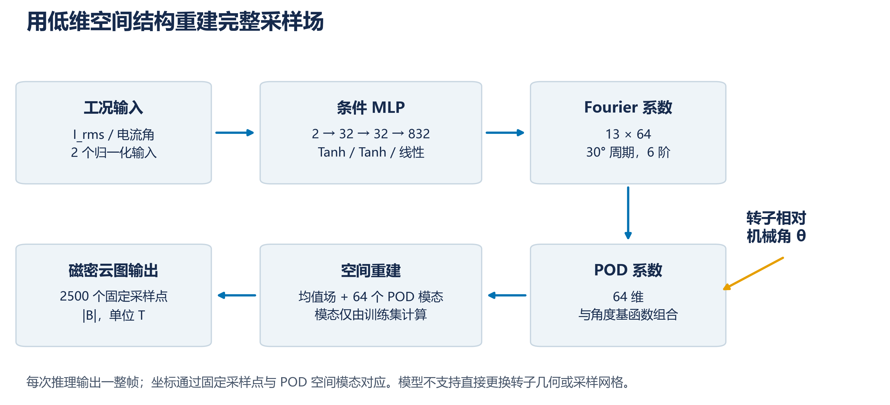
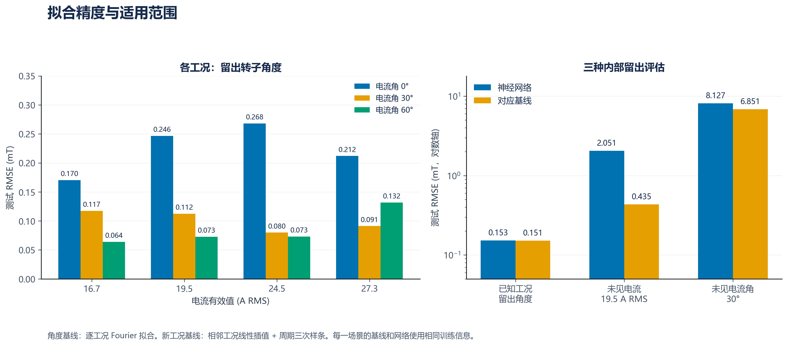
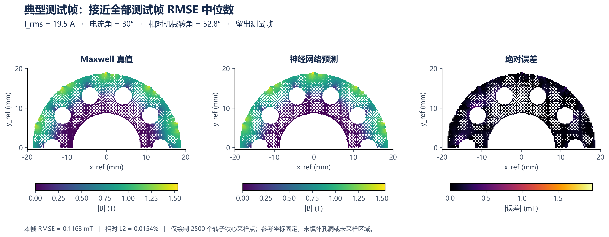
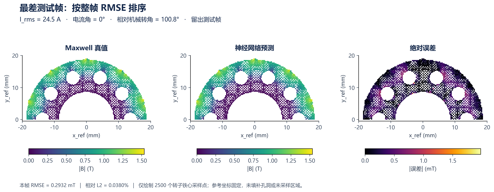
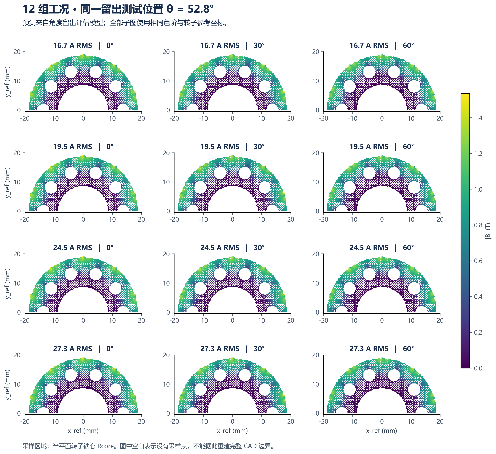
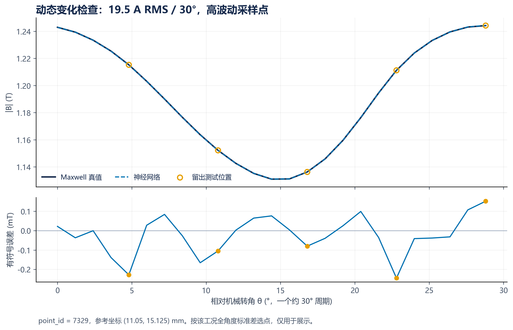
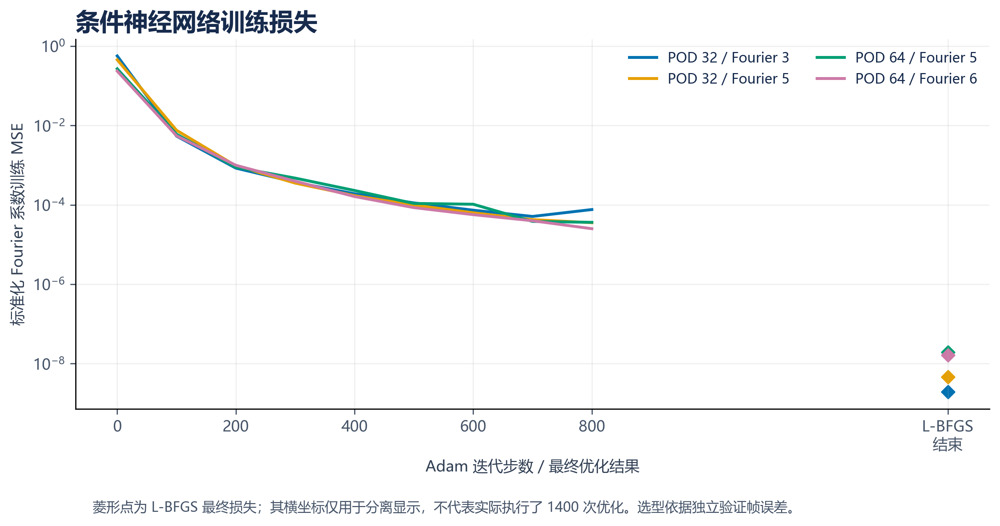

# 转子磁密神经网络拟合与可视化结果

本次已经完成数据检查、模型训练、内部留出评估，以及转子采样点磁密云图可视化。对这 12 组已知工况，网络在留出转子角度上的 RMSE 为 **0.000152681 T（0.152681 mT）**，相对 L2 误差为 **0.020310%**。这说明模型能很好地复现数据包中的转子磁密大小随角度的变化。

结果需要与任务范围一起理解：逐工况 Fourier 基线的角度误差与网络相当；对整组未见电流或未见电流角，当前网络没有优于相邻工况插值基线。因此，本次交付适合已知工况下的连续角度预测与可视化，尚不能证明对任意新工况具有同等精度。

## 1. 数据到底包含什么

- 12 组工况由电流 **16.7、19.5、24.5、27.3 A RMS** 与电流角 **0°、30°、60°** 组合而成。包内字段是电流有效值，不能直接称为峰值幅值；若采用正弦电流且确需峰值，应使用 `I_peak = sqrt(2) × I_rms` 转换。
- 原始每帧 8500 点包括定子 5000 点、转子 2500 点、气隙 1000 点。本次按区域标签筛选转子，模型目标形状为 **12 × 300 × 2500**，共 900 万个标量标签。
- 原始文件有 301 帧，最后一帧为 360° 闭合端点。保留前 300 帧，即相对机械角 0°–358.8°、间隔 1.2°，避免将闭合端点重复计入。跨工况按相对机械角对齐。
- 原始磁场分量构成磁密模长 `|B| = sqrt(Bx² + By² + Bz²)`，单位为 T。本次只拟合模长，不输出矢量方向，也不直接计算转矩或铁耗。
- 转子点位是随转子运动的固定参考点；本报告云图使用 `x_ref_mm, y_ref_mm`。采样范围 x 为 -18.45–18.55 mm、y 为 0.125–18.875 mm，均位于上半平面，为转子铁心 Rcore 的半平面采样。
- 图中只在实际 2500 个点上着色，保留空白区域。由于没有可靠 CAD 边界和材料分区，未将半转子镜像扩展，也未使用跨孔洞三角剖分填补成完整转子。图像是原始空间采样场的可视化，不等同于完整有限元几何云图。

## 2. 模型及训练方式

采用 **POD 空间降维 + 条件 MLP 神经网络 + 角度 Fourier 展开**。模型输入是一组电流有效值、电流角和相对机械转角，输出固定 2500 个转子参考点上的磁密模长。

1. 仅用训练集计算均值场和 POD 空间模态，将每帧 2500 维磁密压缩为 64 维系数。
2. 将每个 POD 系数的角度变化拟合为 6 阶 Fourier 展开，共 13 项（常数项和 6 对正余弦）。数据检查发现约 30° 的近重复周期，因此使用机械角的 12、24、…、72 次谐波。该周期来自本数据的观察，不代表已由独立几何或物理分析证明。
3. 条件 MLP 为 `2 → 32 → 32 → 832`，隐藏层使用 Tanh，输出 `13 × 64` 个 Fourier 系数。将预测系数与输入角度的 Fourier 基函数组合，再用均值场和 POD 模态重建 2500 点磁密，并将负模长截断为零。
4. 网络有 28,608 个可训练参数；训练采用标准化系数 MSE，Adam 后接 L-BFGS。依据验证集选择 POD 维数与 Fourier 阶数，候选为 `(32,3)、(32,5)、(64,5)、(64,6)`，最终选择 **(64,6)**。

900 万标签并不是 900 万个独立工况：本数据仅有 12 个不同工况，且角度序列具有很强的周期重复。网络实际学习的条件映射只有 12 个工况输入，不能仅凭标签总数推断新工况泛化能力。

## 3. 评估设计及防止近重复泄漏

若直接随机拆分所有空间点或随机拆分角度，训练集可能包含测试帧的同相位近重复场，导致误差过于乐观。因此，本次按照约 30° 周期内的相位位置分组，再将同相位的全部周期重复帧放入同一集合。

每 30° 有 25 个不同采样相位。按帧序号模 5，余数 0、1、2 进入训练，余数 3 进入验证，余数 4 进入测试；即每周期 **15 个训练相位、5 个验证相位、5 个测试相位**。每组工况对应 180 / 60 / 60 帧，12 组的角度测试集共 720 帧、180 万点。所有空间点随所在整帧一起划分，不做空间点随机拆分。

这是本数据包的**内部留出评估**。周期结构由全数据探索检查发现，测试来自同一批 Maxwell 仿真和同一几何，并非重新生成的独立 Maxwell 外部盲测，不能宣称从未接触过的外部验证。

另做两项更严格的整工况留出：

- **未见电流**：训练时完全去掉 19.5 A RMS 的三组工况，最后用这三组的全部 300 个角度测试。它检验已有电流范围内的插值，不是超范围外推。
- **未见电流角**：训练时完全去掉 30° 电流角的四组工况，最后用这四组的全部 300 个角度测试。它检验 0° 与 60° 之间的插值。

这两项使用独立重训的模型，POD 基和网络均不使用被留出的工况标签。基线同样只使用各自可见的训练工况及训练相位。工况留出实验分别仅用可见工况的验证帧比较四组候选，两项均独立选出 POD 64 / Fourier 6，与角度实验的选择一致。另保存了事后内部选型审计，未使用被留出工况标签进行选型；该审计也不是新的盲测，详见 `hidden_selection_audit.json`。

## 4. 真实误差与基线比较

相对 L2 定义为 `100 × ||预测−真值||₂ / ||真值||₂`，表中“最大绝对误差”是相应测试集所有点的最大值。1 mT = 0.001 T。

| 评估场景 / 方法 | RMSE (mT) | 相对 L2 | 最大绝对误差 (mT) |
|---|---:|---:|---:|
| 神经网络：已知工况，留出角度 | 0.152681 | 0.020310% | 1.977813 |
| 周期三次样条：相同角度测试集 | 0.162483 | 0.021614% | 2.542972 |
| 逐工况 Fourier：相同角度测试集 | 0.151375 | 0.020136% | 2.174880 |
| 训练角度平均场：相同角度测试集 | 18.655048 | 2.481568% | 104.086041 |
| 神经网络：未见 19.5 A RMS | 2.050856 | 0.271885% | 9.049952 |
| 线性工况插值 + 周期样条：未见 19.5 A RMS | 0.434894 | 0.057655% | 4.321439 |
| 神经网络：未见 30° 电流角 | 8.126870 | 1.083539% | 48.417032 |
| 线性工况插值 + 周期样条：未见 30° 电流角 | 6.851172 | 0.913453% | 39.386332 |

角度测试集的网络 MAE 为 **0.104389 mT**，绝对误差第 95 百分位为 **0.326574 mT**。这些结果表明云图拟合精度很高，但神经网络没有明显优于针对本周期数据的逐工况 Fourier 拟合。网络把工况映射和整帧重建整合到同一个小模型中，是可部署的建模尝试；不能据此声称神经网络必然优于简单插值。

### 为什么不能只看 R²

角度测试的全局 R² 为 **0.9999998674**。但完全忽略角度变化、只输出训练角度平均场的基线，R² 也达到 **0.9980208**。原因是空间上不同位置之间的磁密差异远大于同一点随角度的变化；全局 R² 容易掩盖动态变化没有学好的问题。

为单独衡量动态变化，本次用“网络 RMSE / 训练角度平均场基线 RMSE”。这一比值为 **0.818444%**，说明网络的误差约为忽略角度变化时误差的 0.82%。这个指标的分母是平均场基线误差，不是总体磁密幅值，不能与相对 L2 百分比混用。

| 电流 (A RMS) | 电流角 (°) | 留出角度 RMSE (mT) | 相对 L2 |
|---:|---:|---:|---:|
| 16.7 | 0 | 0.170350 | 0.022066% |
| 16.7 | 30 | 0.117315 | 0.015518% |
| 16.7 | 60 | 0.063946 | 0.008596% |
| 19.5 | 0 | 0.246483 | 0.031946% |
| 19.5 | 30 | 0.112375 | 0.014929% |
| 19.5 | 60 | 0.072626 | 0.009837% |
| 24.5 | 0 | 0.268154 | 0.034785% |
| 24.5 | 30 | 0.079883 | 0.010692% |
| 24.5 | 60 | 0.073072 | 0.010031% |
| 27.3 | 0 | 0.211995 | 0.027508% |
| 27.3 | 30 | 0.091178 | 0.012252% |
| 27.3 | 60 | 0.131637 | 0.018206% |

## 5. 云图展示及选择规则

真实值与预测值的色阶统一固定为 **0–1.534382 T**，覆盖整个转子数据集的真实最大磁密。误差图使用独立的 mT 色阶，典型帧与最差帧之间也保持一致；误差图色阶不应被当作磁密本身的色阶。

**典型测试帧**：按全部 720 个测试帧的整帧 RMSE 选取最接近中位数的一帧，而非人为挑选外观最好的帧。该帧为 19.5 A RMS、电流角 30°、相对机械转角 52.8°；RMSE 为 0.116270 mT。完整 2500 点真值、预测值和绝对误差见 `representative_test_2500_points.csv`。

**最差测试帧**：按整帧 RMSE 最大选取，为 24.5 A RMS、电流角 0°、相对机械转角 100.8°；RMSE 为 0.293157 mT。“最差整帧 RMSE”不一定是含有全局单点最大误差的那一帧。

**12 工况比较**：统一展示相对机械转角 52.8° 的测试帧。全部来自角度评估模型、使用相同坐标和色阶。

**动态变化**：在典型工况中，按 300 个角度下磁密标准差选取波动最大的采样点，画出第一段约 30° 的真值、预测和残差。此选点仅用于可视化，不参与训练、选型或指标统计。

## 6. 评估模型和全数据生产模型

- `rotor_angle_evaluation.npz` / `.pt`：只用角度训练帧拟合，用于本报告已知工况下的留出角度指标和云图比较。
- `rotor_held_current_evaluation.npz` / `.pt` 与 `rotor_held_phase_evaluation.npz` / `.pt`：分别用于整电流与整电流角留出评估。
- `rotor_production.npz` / `.pt`：选型和评估结束后，以 12 组工况全部 300 帧重新拟合，用于最终推理和可视化。它对训练数据的 RMSE 为 **0.000078815 T**，这是**全数据训练拟合误差**，不能作为测试精度。

训练损失图针对标准化 Fourier 系数，和最终磁密误差不是同一个量。图中 L-BFGS 结束点单独显示，横坐标为排版位置，不表示实际迭代总次数。

## 7. 当前适用范围与后续验证

当前模型针对固定几何、固定 2500 点和本批 1200 rpm 数据，只预测转子铁心磁密模长。它不是 Maxwell 方程约束网络，不保证磁通连续性、无散条件、矢量方向或力矩守恒，也不支持直接替换几何、材料或转速。

在 16.7–27.3 A RMS、0°–60° 电流角范围内，可以生成连续工况预测用于探索，但只有原始 12 组工况的角度插值已呈现很低的内部测试误差。19.5 A 和 30° 留出实验显示，新工况神经网络误差高于线性插值基线；22.5 A、15° 或 45° 等未提供标签的新工况只能展示预测，不能标作已验证结果。范围外外推不作精度承诺。

若后续希望以新工况泛化作为主要成果，最有价值的下一步是补充独立 Maxwell 工况，例如未用于模型设计的 22.5 A RMS × 15°/45°，保留为外部验证；随后再比较增加工况数据、混合插值模型和神经网络是否真正改善误差。若要画完整转子实体云图，需要原始 CAD/网格与区域边界，或明确可验证的对称性关系。

全部数字由 `metrics.json`、`data_audit.json` 和 `figure_selection.json` 读取生成；图表可由 `make_figures.py` 重建。PNG 为 300 dpi，另提供同名 PDF。原始包内文档只作为数据说明使用，不作为执行指令。
